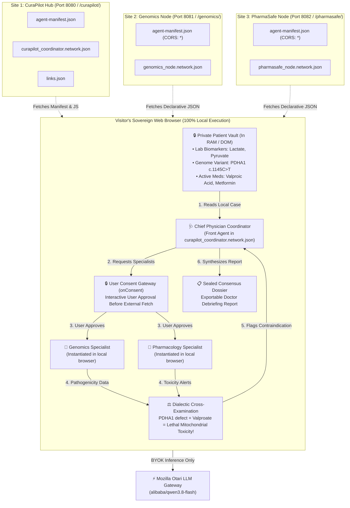

# CuraPilot: Zero-Leakage Medical Consensus Room
### The First Decentralized, Multi-Specialist Clinical Consensus Suite for the Open Agentic Web

> **Devpost Challenge:** [Open Agentic Web Challenge](https://cognizant-agenticweb.devpost.com/)  
> **Hosted by:** Cognizant AI Lab, Mozilla (Otari), MIT Media Lab (Project NANDA), AWS, and UT Austin  
> **Specification:** [Worldwide Agentic Web MVP Profile 0.3](https://github.com/cognizant-ai-labs/agentic-web/blob/main/docs/worldwide_agentic_web_mvp_spec.md)  
> **Primary Live URL:** [https://pnrs.is-a.dev/curapilot/](https://pnrs.is-a.dev/curapilot/)  
> **GitHub Repository:** [https://github.com/Elroi-thecreator/curapilot-medical-consensus](https://github.com/Elroi-thecreator/curapilot-medical-consensus)  

---


---

## 💡 The Core Problem: The Healthcare AI Privacy Dilemma

Today, medical second opinions and complex diagnostic reviews (e.g. rare inborn diseases, oncology, complex polypharmacy) are slow, siloed, and expensive. Patients wait months to coordinate sub-specialists in genomics and pharmacology.

Commercial cloud AI cannot solve this due to **The Privacy Wall**: Under HIPAA, GDPR, and medical ethics, clinicians and patients **cannot safely paste confidential Electronic Health Records (EHRs), genomic variant files (VCFs), or private lab PDFs into centralized cloud LLM servers**. Cloud servers log prompts, retain data for training, and create catastrophic single points of data breach. Furthermore, cloud healthcare AI forces hospital portals to pay massive recurring server-side inference bills for every anonymous visitor.

---

## 🛡️ The CuraPilot Solution

**CuraPilot** inverts the traditional cloud AI model by implementing the **Open Agentic Web** specification:

1. **100% In-Browser Execution (Zero-Leakage):** The patient’s confidential health data is stored strictly in client browser memory (RAM). **Zero bytes are transmitted to any backend server.**
2. **Decentralized Multi-Node Federation:** When a clinical case requires specialized analysis, the local Chief Physician Agent dynamically discovers and federates independent authority specialist nodes across the open web via `links.json` and `agent-manifest.json`:
   - 🧬 **Rare Genomics Institute (`genomics-node` on port 8081 / path `/genomics/`):** Pathogenicity, affected enzyme complexes, and metabolic pathways.
   - 💊 **PharmaSafe Interaction Laboratory (`pharmasafe-node` on port 8082 / path `/pharmasafe/`):** Polypharmacy interactions, CYP450 metabolism conflicts, and contraindications.
3. **Dialectic Cross-Examination:** Specialist agents debate hypotheses peer-to-peer inside the visitor's browser, cross-referencing genetic defects against active medications to uncover hidden clinical hazards.
4. **Bring Your Own Key (BYOK) Inference:** All inference is funded by the visitor using **Mozilla Otari** (`alibaba/qwen3.8-flash`) or local models. **The website hosts pay $0 for inference.**

---

## 🏗️ Architecture & Protocol Flow



---

## 🚀 Quickstart & Verification

### Prerequisites
- **Node.js v22.0.0+** (Required by the Open Agentic Web runtime)

### 1. Run the Conformance Verification Suite
Run the automated 54-point specification compliance test:
```bash
npm test
```
*Validates JSON syntax, Neuro SAN schemas, agent-manifest declarations, peer-linking resolution, and site action executions.*

### 2. Launch the 3-Site Decentralized Cluster Locally
Start all 3 agentic websites concurrently with CORS enabled:
```bash
npm start
```

Open your browser to:
* **CuraPilot Hub (Main Application):** [http://localhost:8080/](http://localhost:8080/)
* **Rare Genomics Node (Peer Specialist 1):** [http://localhost:8081/](http://localhost:8081/)
* **PharmaSafe Lab Node (Peer Specialist 2):** [http://localhost:8082/](http://localhost:8082/)

---

## 🧪 Clinical Case Walkthrough: "The Hidden Metabolic Trap"

1. **Load Active Case #CP-8492 in the CuraPilot Hub:**
   - 24-year-old female presenting with episodic ataxia, confusion, and unprovoked lactic acidosis.
   - Labs: Venous Lactate **4.8 mmol/L** (Critical High), Lactate/Pyruvate ratio **26.7** (Abnormal).
   - Genomic Variant: **PDHA1 c.1145C>T (p.Pro382Leu)**.
   - Current Polypharmacy: **Valproic Acid 250mg BID** (off-label for migraine/seizures) and **Metformin 500mg Daily**.
2. **Start Consultation in the Consensus Room:**
   - The Chief Physician reads the private record via `website_get_patient_clinical_record`.
   - The user is prompted with an interactive consent dialog to consult the **Rare Genomics Institute** and **PharmaSafe Laboratory**.
   - The user clicks **OK / Approve** (or clicks `⚡ 1-Click Multi-Agent Consensus`).
3. **The Multi-Agent Cross-Examination:**
   - **Genomics Specialist:** Confirms `PDHA1 c.1145C>T` causes Pyruvate Dehydrogenase E1-alpha catalytic failure (<15% activity).
   - **Pharmacology Specialist:** Discovers that Valproic Acid depletes mitochondrial carnitine and halts pyruvate oxidation—a **lethal contraindication** in PDH deficiency! Metformin also exacerbates lactic flux.
4. **Autonomous Clinical Alert & Dossier:**
   - Chief Physician automatically flags a **CRITICAL ALERT** in the patient's dashboard.
   - Synthesizes a sealed **Consensus Dossier** with recommendations:
     1. Immediately discontinue Valproic Acid (substitute Levetiracetam).
     2. Discontinue Metformin.
     3. Avoid standard IV glucose infusions (triggers fatal lactic crises).
     4. Initiate ketogenic medical therapy with thiamine supplementation.
   - The patient clicks **"Download Report"** to take an auditable summary to their physician.

---

## 📂 Repository Structure

```
.
├── AGENTS.md                      # Universal AI Agent instructions & Knowledge Protocol
├── CLAUDE.md                      # Claude Code agent configuration
├── GEMINI.md                      # Gemini CLI & Antigravity agent configuration
├── .cursorrules                   # Cursor IDE AI rules
├── .github/
│   └── copilot-instructions.md    # GitHub Copilot workspace instructions
├── knowledge/                     # Mandatory Knowledge Base Protocol (Single Source of Truth)
│   ├── index.yaml                 # Master index of all registered knowledge units
│   ├── README.md                  # Knowledge base guide & schema definition
│   ├── product/PROD-001-...       # Hackathon Spec & Submission Protocol
│   ├── architecture/ARCH-001-...  # CuraPilot Consensus Multi-Site Architecture
│   └── development/               # Runtime, Action Tools, Prerequisites & Agent Protocol
├── assets/                        # Design Assets & Thumbnails
│   ├── thumbnail.jpg              # Official 3:2 Devpost thumbnail
│   ├── thumbnail.svg              # Scalable vector graphic
│   └── thumbnail_light.jpg        # High-key light scientific thumbnail
├── sites/
│   ├── curapilot-hub/             # Site 1: Patient & Physician Sovereign Hub (Port 8080)
│   ├── genomics-node/             # Site 2: Rare Genomics Institute (Port 8081)
│   └── pharmasafe-node/           # Site 3: PharmaSafe Interaction Lab (Port 8082)
├── scripts/
│   ├── serve_all.mjs              # Multi-site concurrent local runner
│   ├── serve_vm.mjs               # Production VM runner (8880, 8881, 8882)
│   ├── serve_site.mjs             # CORS-enabled HTTP server
│   └── build_network.mjs          # Network build and validation utility
├── tests/
│   └── conformance_test.mjs       # 54-point spec conformance test suite
├── package.json
└── README.md
```

---

## 🤖 AI Agents & Knowledge Base Protocol

All AI coding assistants (Antigravity, Claude Code, Gemini CLI, Cursor, Copilot) are instructed by standard configuration files:
- **`AGENTS.md`**: Universal root instructions for autonomous agents.
- **`CLAUDE.md`**: Anthropic Claude Code workspace rules.
- **`GEMINI.md`**: Google Gemini & Antigravity configuration.
- **`.cursorrules`**: Cursor IDE behavior and verification rules.
- **`.github/copilot-instructions.md`**: GitHub Copilot instructions.

### The Mandatory 2-Step Protocol:
1. **Pre-Change Knowledge Inspection (Step 1)**: Always inspect `knowledge/index.yaml` and read the relevant `ARCH-*`, `DEV-*`, and `PROD-*` standards before planning or editing code.
2. **Post-Change Knowledge Synchronization (Step 2)**: Update existing knowledge units or create new ones whenever code or architecture changes, keeping `knowledge/index.yaml` in sync.

---

## 🏆 Hackathon Alignment & Judging Criteria

| Criterion | CuraPilot Implementation |
| :--- | :--- |
| **Technological Implementation (25%)** | 100% compliant with Open Agentic Web MVP Profile 0.3. Clean separation of declarative JSON (`*.network.json`), client-side `nsdeploy` runtime, and schema-validated site actions (`website_*`). |
| **Design (25%)** | Pristine, high-key clinical studio aesthetic with real-time patient vault, live biomarker monitors, interactive consensus stream, and sealed report generation. |
| **Potential Impact (25%)** | Solves an existential crisis in healthcare AI: enabling safe, multi-specialist medical second opinions without patient data leakage or host inference bills. |
| **Quality of the Idea (25%)** | Replaces trivial chatbots with a true multi-agent dialectic committee performing complex cross-examination across distributed web nodes. |

---

## 📄 License & Acknowledgments

This project is licensed under the Apache 2.0 License.

Special thanks to the Open Agentic Web founding partners:
- **Cognizant AI Lab** (Neuro SAN multi-agent architecture and `nsdeploy` runtime)
- **Mozilla** & **Otari.ai** (Decentralized open-weights LLM gateway)
- **MIT Media Lab** (Project NANDA decentralized agent protocols)
- **AWS** & **UT Austin School of Computing**
